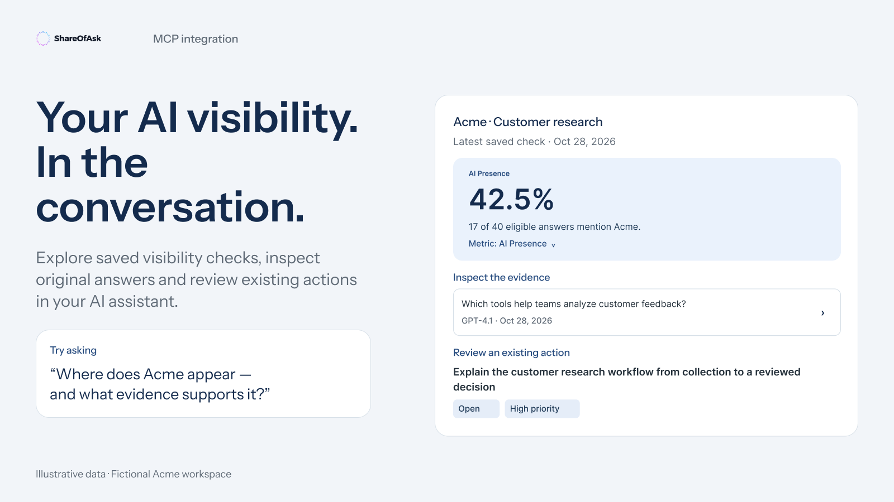

# ShareOfAsk MCP

**Bring your AI visibility data into the conversation.**

Connect ShareOfAsk to your AI assistant to explore how models mention your brand, compare competitors, inspect original answers and work through your saved action plan.

[**Start Free Scan →**](https://app.shareofask.com/sign-up) · [**Connect your ShareOfAsk account →**](docs/getting-started.md)

New to ShareOfAsk? Start with a one-time Free Scan. No credit card required. Review your results for 7 days, including through MCP while scan access is active.



[Browse the playbooks](#start-with-your-work) · [Try a prompt](docs/prompt-library.md) · [Visit ShareOfAsk](https://www.shareofask.com/)

This is the official connection and usage guide for **ShareOfAsk's hosted MCP service**. You use your existing ShareOfAsk account and the workspaces you authorize. There is no server to install from this repository.

**MCP access is included with Free Scan, Starter, Growth and Enterprise.** Your workspace permissions, available data and plan access limits still apply. [Compare plans](https://www.shareofask.com/pricing).

## Start with your work

| Your team | What you can do | Playbook |
| --- | --- | --- |
| Agencies and consultants | Prepare client reviews, investigate competitive gaps and review shared actions. | [Agency workflows](docs/playbooks/agencies.md) |
| Marketing and brand teams | Review visibility changes, examine brand positioning and prioritize work with evidence. | [Marketing workflows](docs/playbooks/marketing-teams.md) |
| SEO and content teams | Find questions where competitors appear, inspect cited sources and draft content briefs. | [Content and SEO workflows](docs/playbooks/content-seo.md) |

Each playbook includes copyable prompts, the data you need and what a useful result should contain. All illustration data is fictional.

## Connect your account

1. Choose a [compatible MCP client](docs/clients/compatibility.md) and add ShareOfAsk's hosted URL:

   ```text
   https://api.shareofask.com/mcp
   ```

2. Sign in to ShareOfAsk and choose the organization, workspaces and permissions for this connection. Start with the read permissions you need; write access is optional.
3. Ask your assistant to list accessible workspaces, then choose one by name.

```text
Use ShareOfAsk to list the workspaces I can access. After I choose one,
show its latest available visibility results and the dates of the saved
measurements. Explain any missing or partial data. Do not change anything.
```

Follow the full instructions for [ChatGPT](docs/clients/chatgpt.md), [Codex](docs/clients/codex.md) or [Claude](docs/clients/claude.md). Availability and interactive-panel support depend on the client. See the [verification status](docs/clients/compatibility.md); a guide is not a claim of app-directory approval.

**No data yet?** [Start a Free Scan in ShareOfAsk](https://app.shareofask.com/sign-up), wait for your results, then connect your assistant to explore them. Visibility analysis needs saved measurements; recommendations need an existing action plan. MCP does not run measurements or generate recommendation runs.

<details>
<summary><strong>Codex: copy-and-paste setup</strong></summary>

Add this entry to `~/.codex/config.toml`, preserving your existing configuration:

```toml
[mcp_servers.shareofask]
url = "https://api.shareofask.com/mcp"
```

Then sign in with read permissions:

```sh
codex mcp login shareofask --oauth-client-registration dcr --scopes workspaces:read,competitors:read,questions:read,metrics:read,mentions:read,responses:read,sources:read,recommendations:read
```

Finish sign-in and choose workspace access in your browser. See the [Codex guide](docs/clients/codex.md) for verification notes. ChatGPT and Claude use their own connection screens; follow their guides above.

</details>

## Five focused views

In clients that support MCP Apps, your assistant can open a focused panel. Otherwise, tools return data as text.

| View | Start here when you want to… |
| --- | --- |
| **Visibility** | Check one metric, explore trends, compare brands or inspect two saved measurements. |
| **Answers** | Read original model responses with the original question, model, date and citations. |
| **Sources** | Explore cited websites, individual URLs and answers that mention competitors but omit your brand. |
| **Action plan** | Open an individual saved recommendation, its steps and available evidence. |
| **Questions** | Review tracked questions and their history; optionally edit an existing question. |

Lists show three items at a time. Details open progressively, and **Ask about this** sends the selected context back to the assistant. Browsing or expanding a section does not save a change. [More about tools and views →](reference/tools.md)

## Tools at a glance

The service provides **14 read tools and 2 optional write tools**, plus **5 tools for opening interactive views** in compatible clients. Tools available to a connection depend on its permissions and enabled features.

<details>
<summary><strong>See the 16 core tools</strong></summary>

| Tool | What it does |
| --- | --- |
| `list_workspaces` | Find workspaces you can access. |
| `get_workspace` | Read a workspace's configuration and context. |
| `get_methodology` | Read metric definitions and interpretation guidance. |
| `list_competitors` | Read configured competitors and observed brands. |
| `list_questions` | Read tracked questions and their versions. |
| `list_snapshots` | Find saved measurements and their dates. |
| `get_metrics` | Read visibility metrics, trends and full-measurement comparisons. |
| `list_mentions` | Find brand mentions and supporting context. |
| `list_responses` | Find original measurement responses using filters. |
| `get_response` | Read a complete original measurement response. |
| `list_sources` | Explore citations and cited URLs. |
| `list_source_domains` | Explore the domains cited in responses. |
| `get_response_sources` | Read citations associated with one response. |
| `get_recommendations` | Read existing recommendation analyses and shared actions. |
| `update_question` | With write access, edit an existing question's text, theme or tags. |
| `update_recommendation_status` | With write access, change an existing shared action's status. |

</details>

The view tools are `show_visibility`, `show_responses`, `show_sources`, `show_action_plan` and `show_questions`. The [full tool reference](reference/tools.md) includes arguments, permissions and the app-only context tool.

## Know what you are looking at

ShareOfAsk provides saved measurements and evidence. Your assistant can help interpret them or draft a report, but its interpretation is separate from the original model response.

- Check measurement dates and scope before comparing results.
- Missing data is not zero, and one page of results is not a total.
- A citation shows that a source was cited; it does not prove the source caused a recommendation or verify the page's content.
- Access follows your connection permissions and current workspace, role and plan access.
- Optional writes can edit an existing question or update an existing shared action's status. They affect shared data. [Understand write access](docs/permissions.md) before enabling it.

[Data and metric definitions](docs/data-and-metrics.md) · [Permissions](docs/permissions.md) · [Troubleshooting](docs/troubleshooting.md)

## Help improve the guide

Found an unclear step or have a useful workflow to share? Read [CONTRIBUTING.md](CONTRIBUTING.md) and [open an issue](https://github.com/ShareOfAsk/shareofask-mcp/issues/new/choose). Keep account details, credentials and private client data out of public issues.

## Reuse these materials

Adapt the guides, prompts and workflow illustrations for your team or client training under **CC BY 4.0**, with attribution to ShareOfAsk. Scripts and code/configuration examples use **MIT**. [Licensing and brand guidelines](LICENSING.md) explain the scope and include an attribution example.

[What's changed](CHANGELOG.md) · [Documentation roadmap](ROADMAP.md) · [Support](SUPPORT.md) · [Start Free Scan](https://app.shareofask.com/sign-up)
