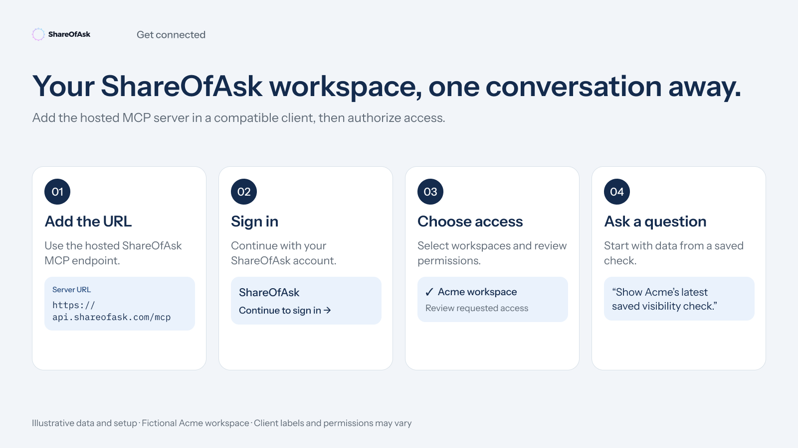

# Connect ShareOfAsk to your assistant

Bring the AI visibility data already in ShareOfAsk into a conversation: compare results, inspect full model answers, investigate citations, and review your team's action plan.

You need a ShareOfAsk account with access to a workspace and an assistant that supports remote MCP with OAuth. Existing measurements make the connection useful; connecting does not create a measurement.

**No data yet?** [Start a Free Scan](https://app.shareofask.com/sign-up) in ShareOfAsk. No credit card is required. Wait for the scan to finish, then follow the connection steps below to explore its results with your assistant. Free Scan is a one-time check with 7 days of result access; MCP respects that access window.

MCP access is included with **Free Scan, Starter, Growth and Enterprise**. Your available data, workspace permissions and plan access limits apply. See the [current plans](https://www.shareofask.com/pricing). Your assistant may have separate requirements for custom connections.



## 1. Add the connection

Use the instructions for your assistant:

- [ChatGPT](clients/chatgpt.md)
- [Codex](clients/codex.md)
- [Claude (setup guidance, not yet verified)](clients/claude.md)

Enter this hosted server URL:

```text
https://api.shareofask.com/mcp
```

Use OAuth sign-in. You do not need to install a ShareOfAsk package, run a server, or provide a ShareOfAsk API key. If the assistant asks how to register its OAuth client, choose dynamic client registration (DCR).

## 2. Choose access in ShareOfAsk

Sign in to ShareOfAsk and select **one organization**. Choose either:

| Access | When to choose it |
| --- | --- |
| Selected workspaces | You want the assistant to work with specific brands or clients. This is the default. |
| All current and future workspaces | You want a connection that follows new workspaces in this organization as they become accessible to you. |

Review the requested read permissions. Leave optional write permissions unchecked for a reporting-only connection. [Permissions and optional changes](permissions.md) explains what each choice allows.

Your current role and product access still apply to every request. A connection cannot grant access you do not have in ShareOfAsk.

## 3. Start with one workspace

Select or enable the ShareOfAsk connection in the conversation, then ask:

> Use ShareOfAsk to list the workspaces available to this connection. Show their names and ask me which one to analyze.

After selecting a workspace:

> Read the ShareOfAsk methodology and review the latest available visibility results for this workspace. Tell me whether my brand appears, which competitors appear, and which dates and models the results cover. Include the stored answers that support the main findings. Explain missing or partial data. If only one measurement is available, report it without claiming a trend. Do not change anything.

In an assistant that supports the embedded views, try:

> Open ShareOfAsk Visibility for this workspace, then show Sources so I can inspect the cited domains.

The five views are **Visibility**, **Answers**, **Sources**, **Action Plan**, and **Questions**. An assistant without a compatible visual interface can use the data tools to answer in the conversation. See the [client compatibility notes](clients/compatibility.md) for the tested scope.

## 4. Build a useful workflow

For client reporting, use the [agency playbook](playbooks/agencies.md). For an in-house review, use the [marketing team playbook](playbooks/marketing-teams.md). To turn source evidence into a research brief, use the [content and SEO playbook](playbooks/content-seo.md). Before quoting numbers in a report, check [how to interpret the data](data-and-metrics.md).

This integration reads existing results. It cannot start measurements, generate new ShareOfAsk recommendations, create or delete questions, change schedules, or manage billing. With separate consent, it can edit an existing question's text, theme, or tags and update a shared action's status.

You can revoke access in [ShareOfAsk Account Settings → Integrations](https://app.shareofask.com/account/integrations).

[Back to the integration hub](../README.md) · [Troubleshooting](troubleshooting.md) · [Tool reference](../reference/tools.md)
