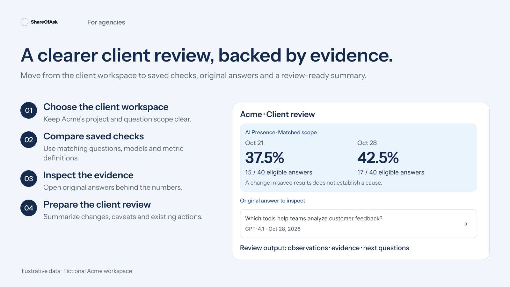

# ShareOfAsk for agencies and consultants

Turn saved client measurements into a review your team can explain: what changed, which answers support the finding and which existing actions deserve attention.



[Connect your account](../getting-started.md) · [Prompt library](../prompt-library.md) · [All playbooks](../../README.md#start-with-your-work)

Use one client workspace at a time. Replace `[client workspace]` with its name; if several workspaces match, have the assistant ask you to choose. These workflows read existing data and draft material in your conversation. They do not send reports to clients or create measurements.

## 1. Prepare a client performance review

**Use when:** you have at least two saved measurements and need a clear account of movement since the previous review.

**Start with:** access to the client's workspace, saved measurement dates and the reporting period you want to discuss.

```text
Use ShareOfAsk for [client workspace]. List the available saved measurements
in [reporting period] and help me choose a baseline and a follow-up.

Compare those two complete measurements using ShareOfAsk's returned metrics.
Keep this comparison separate from filtered trend analysis. State the dates,
scope, missing or partial results, and whether the question or model sets changed.

Inspect original answers that illustrate the main differences. Draft a client
review with: observed changes, supporting answer references, limitations,
and existing saved actions worth discussing. Separate evidence from hypotheses.
Do not change data or send the review.
```

**You should get:** a dated comparison, a few inspectable answer references and a draft narrative tied to the evidence. If two comparable measurements are unavailable, the assistant should explain that rather than manufacture a trend.

**Review before sharing:** changes in the question or model set can change the denominator. Ask for the scope alongside every headline number. Improved visibility in a later measurement does not, by itself, prove that your agency's work caused it.

**Follow-up:** “Open the original answer behind the largest difference, then show the available citations separately.”

## 2. Find a competitive gap worth discussing

**Use when:** a client asks where competitors appear while their brand is missing.

```text
In [client workspace], show saved answers that mention a configured competitor
but omit our tracked brand. Tell me the measurement dates and filters used.
Start with three examples and clearly label the number shown versus any total
returned by ShareOfAsk.

For each example, show the original question, model, answer reference and the
competitor mentioned. Let me inspect the full answer and its cited sources.
Group the examples into potential discussion topics without treating this
page as the full set of gaps. Do not infer that a citation caused the omission.
```

**You should get:** specific answer-level gaps that you can inspect, not a generic list of SEO suggestions. The next page may contain more examples; the assistant should continue pagination when you ask for a complete inventory.

**Review before sharing:** a gap here means “competitor mentioned, tracked brand omitted.” It does not mean the competitor bought placement, that a cited site endorses the competitor, or that ShareOfAsk inspected the site's current content.

**Follow-up:** “Open the saved actions relevant to this topic, one recommendation at a time. If there are none, say so.”

## 3. Prepare an action-plan meeting

**Use when:** account managers, strategists and the client need to review an existing shared action plan.

```text
Open the existing shared action plan for [client workspace]. Help me choose
three actions for our next client meeting using their saved priority, status,
steps and available evidence. Identify outdated or weak evidence explicitly.

Open each selected recommendation in its own panel when the client supports
that. Draft a meeting agenda with the decision needed, the evidence to review
and a proposed owner for discussion. Owners and due dates are suggestions in
this draft, not saved assignments. Do not change any action status.
```

**You should get:** a short agenda and inspectable recommendations. Opening three separate panels depends on the AI client's display capabilities; a compact list or individual panel is a valid fallback.

**Optional after agreement:** authorized users can update an existing shared action to `open`, `done` or `dismissed`, with the applicable reason or evidence. Use the explicit status form, or give a deliberate instruction to the assistant after reviewing [write permissions](../permissions.md). Do not treat opening the recommendation as approval to update it.

## Working across client accounts

Keep the workspace name in every prompt and report. A connection only exposes workspaces covered by your authorization and current access. If you have several client organizations, check the connection's organization and scope before starting. A wider grant does not create a cross-client reporting warehouse or authorize sharing one client's data with another.

[Next: understand the metrics](../data-and-metrics.md) · [Back to the guide](../../README.md)
