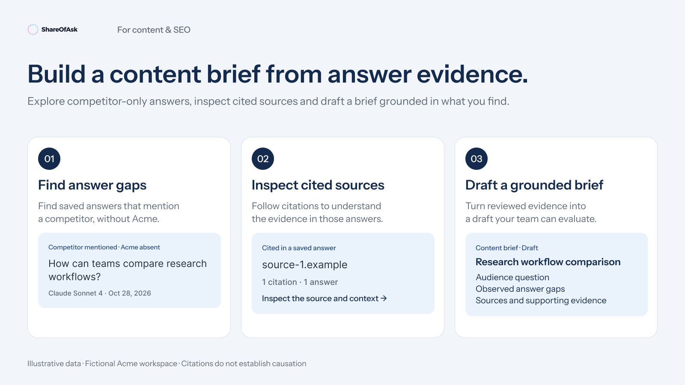

# ShareOfAsk for content and SEO teams

Move from an observed answer gap to a content brief with traceable evidence. Use model responses and citations to frame questions worth investigating.



[Connect your account](../getting-started.md) · [Prompt library](../prompt-library.md) · [All playbooks](../../README.md#start-with-your-work)

Replace `[workspace]` and `[topic]` before using a prompt. ShareOfAsk MCP reads saved answers and citations; it does not fetch and audit the current contents of every cited page.

## 1. Find buyer questions where your brand is absent

**Use when:** you want specific questions to investigate before choosing a content project.

```text
Use ShareOfAsk for [workspace]. Find existing tracked questions related to
[topic], then inspect saved answers that mention a configured competitor but
omit our tracked brand.

Show three examples with the exact original question, model, measurement date,
competitor and answer reference. State the filters and distinguish the number
shown from any backend total. Let me open each full answer.

Suggest possible content questions to investigate, clearly labeled as your
hypotheses. Do not claim that creating a page will cause AI models to recommend us.
```

**You should get:** an inspectable starting point for research. If your tracked question set does not cover the topic, the assistant should say so; absence from this dataset is not proof of absence across all AI answers.

**Follow-up:** “Continue through the remaining matching results before summarizing how often this pattern appears. Report any access or history limit.”

## 2. Inspect the source landscape

**Use when:** you want to understand which sources appear in the selected answer context.

```text
For the selected answers in [workspace], show the cited domains and exact URLs
available in ShareOfAsk. Keep each source connected to its original question,
answer, model and measurement date. Use returned citation counts and explain
their scope rather than estimating totals from the loaded rows.

Group the sources into a reading list for [topic]. Distinguish provider
citations from links extracted from answer text when that information is
available. Do not infer current page content, editorial endorsement or causal
influence from a citation alone.
```

**You should get:** an evidence-linked reading list and a way to return to the original answers. A citation's title, URL or stored category is not a substitute for inspecting the page.

**Review before outreach:** the presence of a domain does not establish that it accepts contributions, sells placements or is a suitable outreach target. Any separate live-web research should be labeled as a different source of evidence.

**Follow-up:** “Which conclusions can we support from these saved records, and which require separate research?”

## 3. Draft a content brief from the evidence

**Use when:** you have selected a question or gap and want a draft the content team can review.

```text
Using the selected ShareOfAsk evidence for [workspace] and [topic], draft a
content brief in this conversation. Include the buyer question, intended
audience, observed answer gap, supporting answer and citation references,
proposed outline, claims needing verification and open research questions.

Separate three categories: facts from saved ShareOfAsk records, model claims
that need independent checking, and your editorial suggestions. Do not invent
search volume, traffic, conversion forecasts or expected AI visibility uplift.

If there is a relevant existing saved action, reference it. Otherwise keep
this as a new draft suggestion; do not create a recommendation run, publish
content or change tracked questions.
```

**You should get:** a draft brief with a clear evidence trail and an explicit verification list. It is conversation output, not a document automatically saved to ShareOfAsk or your content system.

**After publication:** when later measurements already exist, compare them with an appropriate baseline. Keep question/model changes visible and avoid claiming that before/after movement proves the content caused it.

[Next: data and interpretation](../data-and-metrics.md) · [Back to the guide](../../README.md)
