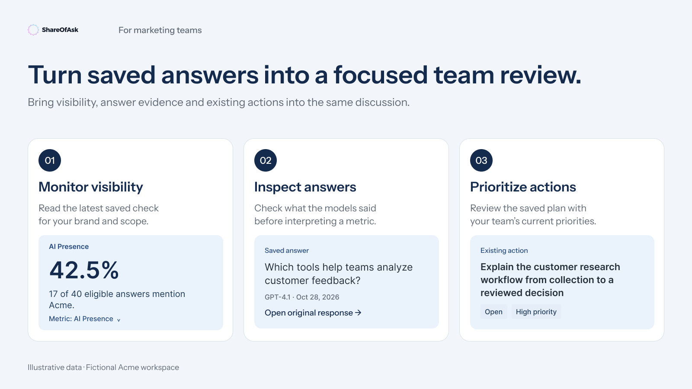

# ShareOfAsk for marketing and brand teams

Use saved AI visibility data in planning conversations: inspect a change, understand how a model describes your brand and decide what to review next.



[Connect your account](../getting-started.md) · [Prompt library](../prompt-library.md) · [All playbooks](../../README.md#start-with-your-work)

Replace `[workspace]` with your workspace name. These prompts produce analysis or drafts in your conversation; they do not start checks, schedule monitoring or create recommendation runs.

## 1. Run a weekly visibility review

**Use when:** the team wants a quick, repeatable view of the saved results available this week.

```text
Use ShareOfAsk for [workspace]. Show AI Presence for the available saved
measurements in the last month. State the latest measurement date, the data
scope and any missing or partial results. If nothing new was measured this
week, say that clearly.

Identify up to three changes worth investigating. For each, explain which
returned metric or original answer supports it, then let me inspect the
evidence. Finish with a short team-review note separating observations,
hypotheses and unanswered questions. Do not run a new measurement or change data.
```

**You should get:** a concise review with dates, definitions and evidence—not a new dashboard snapshot generated at the time of the conversation.

**Review before sharing:** the panel's preparation time is not the date of the measurement. Keep stale-data and partial-result notes in the team summary.

**Follow-up:** “Show the model breakdown using the measures actually available; explain any differences in scope.”

## 2. Investigate how AI describes your positioning

**Use when:** product marketing or brand teams want to examine a specific message, use case or competitive comparison.

```text
In [workspace], find tracked questions relevant to [topic or use case]. Use
their existing identifiers to inspect matching saved responses. Show the
original question, model and date for each example.

What language do these answers use to describe our brand and configured
competitors? Quote short relevant passages and retain references to the full
original answers. Distinguish direct observations from your interpretation,
and tell me if the sample is too small or the topic is not covered.

Do not infer that model descriptions verify real product features, and do not
rewrite the saved questions or responses.
```

**You should get:** a grounded view of model perception in the available question set, including disagreements between models. A model's claim about a feature is evidence of what that model said, not independent verification of the feature.

**Follow-up:** “Draft three positioning questions for our team to investigate. Keep them as suggestions here; do not add or edit tracked questions.”

## 3. Prepare an evidence-led prioritization session

**Use when:** the team has an existing action plan and wants to decide what is worth discussing this cycle.

```text
Open the saved action plan for [workspace]. Compare up to five existing actions
using their saved status, priority, instructions and available evidence.

Draft a shortlist of three actions for our planning meeting. For each, explain
why it deserves discussion, the uncertainty in the evidence and the decision
we need to make. Keep your proposed order separate from saved priorities.
Do not invent an effort estimate, owner, due date or expected uplift as if
ShareOfAsk had stored it. Do not change statuses.
```

**You should get:** a decision aid with links or identifiers for the existing actions. The assistant's proposed order is a draft; it does not alter saved priorities.

**Review before acting:** recommendations can contain earlier analysis summaries or research evidence. Some older items may not link to a full original source. Keep those limitations visible rather than presenting every item as equally verified.

**Follow-up:** “Open the first recommendation's saved evidence and explanation. What would we need to verify before acting?”

[Next: understand permissions](../permissions.md) · [Back to the guide](../../README.md)
